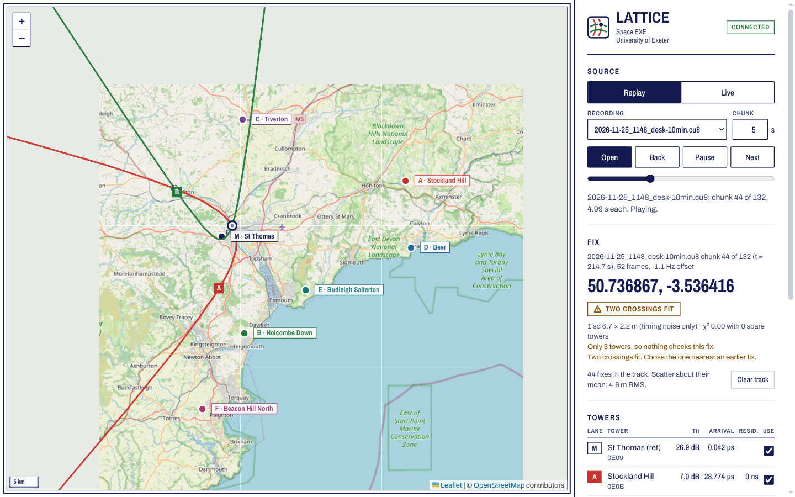
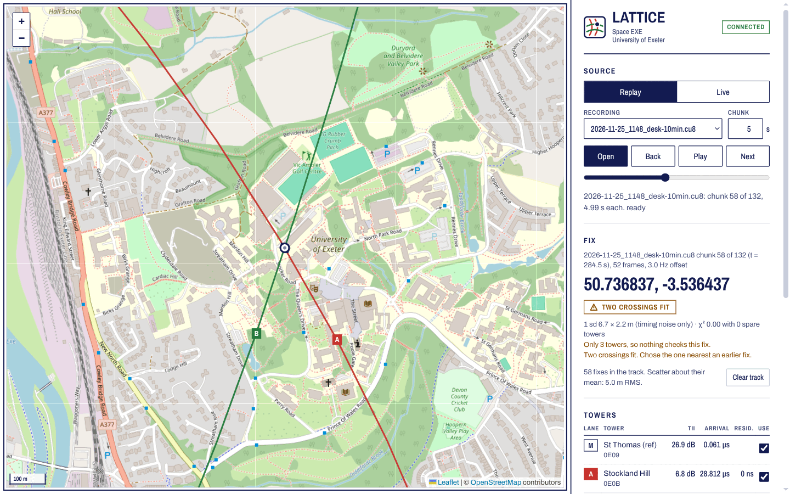
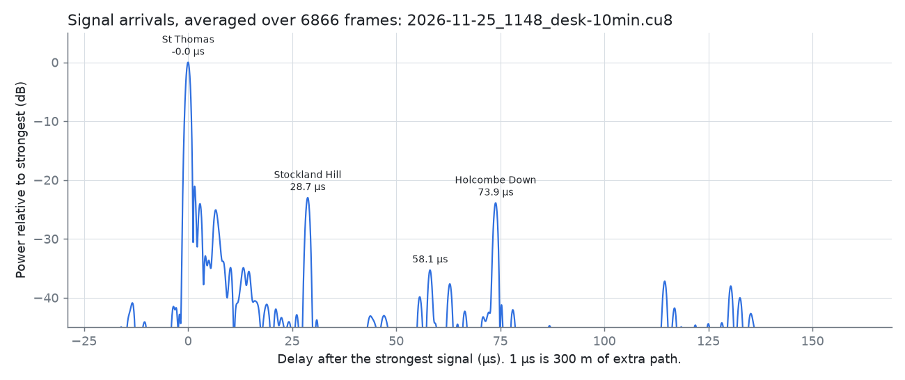

<p align="center">
  
</p>

<h1 align="center">Space EXE tools</h1>

<p align="center">
  Software from Space EXE, the University of Exeter space society.<br>
  We build hobby rockets and fly them under the UKRA safety code.
</p>

<p align="center">
  <a href="LICENSE"></a>
  
  
</p>

## TowerFix

TowerFix positions a receiver without GPS. It times the signals from the
BBC National DAB towers around Exeter (block 12B, 225.648 MHz) and finds
where the time differences cross. The aim is to track a rocket in flight.
For now it runs on the ground with an RTL-SDR dongle.

Lattice is the TowerFix map. It replays recordings or reads the dongle
live, and plots one fix every 5 seconds.



Zoomed in, the fix is the navy ring where the lanes cross. On the desk
recording the fixes scatter by about 5 m RMS.



`ground-test/analyse.py` checks a recording offline. It reports which
towers it can hear and when each signal arrives.



## Setup

You need:

- an RTL-SDR dongle and an antenna for about 225 MHz (we use the RTL-SDR
  Blog V3 and its dipole kit, arms about 32 cm, held vertically)
- [uv](https://docs.astral.sh/uv/), which installs Python and numpy for you
- `rtl_sdr` on your `PATH`, for recording and live mode
- a site in range of the Exeter towers in `towerfix/towers.json`

The repo has no recordings, because a 10-minute one is about 2.5 GB. Make
your own, or use live mode.

### Linux

Tested on Fedora with `rtl-sdr` 2.0.1.

```sh
# 1. Tools
sudo dnf install rtl-sdr          # Debian/Ubuntu: sudo apt install rtl-sdr
curl -LsSf https://astral.sh/uv/install.sh | sh

# 2. Stop the kernel's DVB-T driver claiming the dongle, then replug it
echo 'blacklist dvb_usb_rtl28xxu' | sudo tee /etc/modprobe.d/blacklist-rtl-sdr.conf
sudo modprobe -r dvb_usb_rtl28xxu

# 3. Check the dongle (Ctrl+C after a few seconds, expect no lost samples)
rtl_test -s 2048000

# 4. Get the code and cache the map tiles (once, about 900 tiles)
git clone https://github.com/zi-vinnie/space-exe-tools.git
cd space-exe-tools/towerfix/web
uv run fetch_tiles.py

# 5. Start Lattice
uv run server.py
```

Open <http://127.0.0.1:8765/>. If `rtl_test` says it can't open the
device, your user may need the udev rules from your distro's `rtl-sdr`
package. Replug the dongle after installing them.

### Windows

We haven't tested on Windows yet. The Python code has nothing
Linux-specific, so these steps should work. Tell us if they don't.

1. Install uv in PowerShell:

   ```powershell
   powershell -ExecutionPolicy ByPass -c "irm https://astral.sh/uv/install.ps1 | iex"
   ```

2. Download the Windows build of the RTL-SDR tools from
   [rtlsdrblog/rtl-sdr-blog releases](https://github.com/rtlsdrblog/rtl-sdr-blog/releases).
   Unzip it somewhere like `C:\rtl-sdr` and add that folder to your `PATH`.
3. Plug in the dongle and run [Zadig](https://zadig.akeo.ie/). Choose
   Options, List All Devices, pick "Bulk-In, Interface (Interface 0)", and
   install the WinUSB driver.
4. Check the dongle in a new terminal: `rtl_test -s 2048000`.
5. Clone the repo, cache the tiles and start Lattice:

   ```powershell
   git clone https://github.com/zi-vinnie/space-exe-tools.git
   cd space-exe-tools\towerfix\web
   uv run fetch_tiles.py
   uv run server.py
   ```

6. Open <http://127.0.0.1:8765/>.

### Making a recording

Recordings are raw 8-bit I/Q at 2.048 MS/s, so 30 seconds is 61,440,000
samples (about 120 MB). From `towerfix/`:

```sh
rtl_sdr -f 225648000 -s 2048000 -g 20 -n 61440000 recordings/2026-11-25_1400_mysite.cu8
```

- A gain of about 20 dB suits indoors. Higher gain clips.
- Keep each file under 2 GB (about 8 minutes). `rtl_sdr -n` doesn't stop
  past that, so split longer runs or stop them with a timer.
- Write the site's GPS position in a `.txt` file of the same name, so you
  can mark the true position in Lattice later.

Then pick the file in Lattice's Replay tab, or check it offline:

```sh
cd ground-test
uv run analyse.py ../recordings/2026-11-25_1400_mysite.cu8
```

## Using Lattice

- **Replay.** Pick a recording, press Open, then Play or step with Next
  and Back.
- **Live.** Set the gain and press Start. The server runs `rtl_sdr` itself.
- **Towers.** Untick a tower to leave it out of the fix. Its lane still
  shows dashed, so you can see whether it agrees.
- **True position.** Click the map where the antenna really is, to see each
  fix's error.
- **Calibrate here.** Re-measures each tower's network offset assuming the
  click is the true position, and saves `offsets.json`. The offsets in the
  repo come from our desk site. A new site will need its own calibration,
  and with only three towers the fix can't check itself.

`towerfix/web/README.md` has the details, including how the fix works.

## What's in the repo

| Path | What it is |
| --- | --- |
| `towerfix/towerfix/` | Shared Python package: tower timing, the fix solver, chunked reading |
| `towerfix/web/` | Lattice: `server.py`, the page, `replay.py` for fixes without a browser |
| `towerfix/ground-test/` | `analyse.py`, the test log and results |
| `towerfix/towers.json` | Tower positions and TII codes |
| `PRODUCT.md`, `DESIGN.md` | Who Lattice is for and its visual rules |

## Licence

MIT, see `LICENSE`. Leaflet in `towerfix/web/static/vendor/` has its own
BSD-2-Clause licence, and the Archivo fonts in `vendor/fonts/` use the SIL
Open Font Licence. Map tiles are © OpenStreetMap contributors.
